<div align="center">

# Cortex

### The agentic AIOps cockpit for OpenStack IaaS

**Monitor · Understand · Predict · Secure · Propose fixes — with a human always in the loop.**


</div>

---

> ⚠️ **DISCLAIMER — SIMULATION DATA**
>
> All screenshots in this README come from a **sandbox (simulation) environment**. **None of the data shown comes from the actual OpenStack infrastructure**, for confidentiality reasons.

> *We built an environment-agnostic intelligence layer whose adapters turn heterogeneous infrastructure telemetry into a common operational model. We validated the core pipeline in a controlled sandbox and are now tuning its parameters against a real OpenStack environment.*

---

## Table of contents

1. [What is Cortex?](#1-what-is-cortex)
2. [Feature overview](#2-feature-overview)
3. [Screenshots](#3-screenshots)
4. [Architecture](#4-architecture)
5. [Tech stack](#5-tech-stack)
6. [Monitoring](#6-monitoring)
7. [Anomaly detection](#7-anomaly-detection)
8. [The Living Model (digital twin)](#8-the-living-model-digital-twin)
9. [Forecasting & capacity planning](#9-forecasting--capacity-planning)
10. [Agentic AI](#10-agentic-ai)
11. [RAG & knowledge base](#11-rag--knowledge-base)
12. [Remediation Copilot](#12-remediation-copilot)
13. [Security](#13-security)
14. [FinOps, reports & notifications](#14-finops-reports--notifications)
15. [OpenStack adoption](#15-openstack-adoption)
16. [Backend services & API](#16-backend-services--api)
17. [Data model](#17-data-model)
18. [Repository layout](#18-repository-layout)
19. [Getting started](#19-getting-started)
20. [Configuration](#20-configuration)
21. [Testing, CI & evaluation](#21-testing-ci--evaluation)
22. [Architecture Decision Records](#22-architecture-decision-records)
23. [Roadmap & delivery status](#23-roadmap--delivery-status)

---

## 1. What is Cortex?

Cortex is an **AI operations platform for OpenStack IaaS**. It started as a Prometheus dashboard and grew into a full operational brain:

- it **collects** real telemetry (metrics, logs, OpenStack state, kernel-level security signals),
- it **models** the infrastructure as a graph (nodes → services → containers → networks → instances) so alerts have *context*,
- it **predicts** capacity exhaustion and simulates "what-if" scenarios,
- it exposes a **single conversational cockpit** backed by a team of specialist LangGraph agents,
- it **proposes** fixes in plain language, simulates their blast radius against the graph, and executes them **only after an explicit human click** — with a tamper-evident audit trail.


> ⚠️ **DISCLAIMER — SIMULATION DATA**
>
> The screenshots shown below are taken from a **simulation app**.  
> **None of the displayed data comes from the actual OpenStack infrastructure**, for confidentiality reasons.

| | |
|:--:|:--:|
| 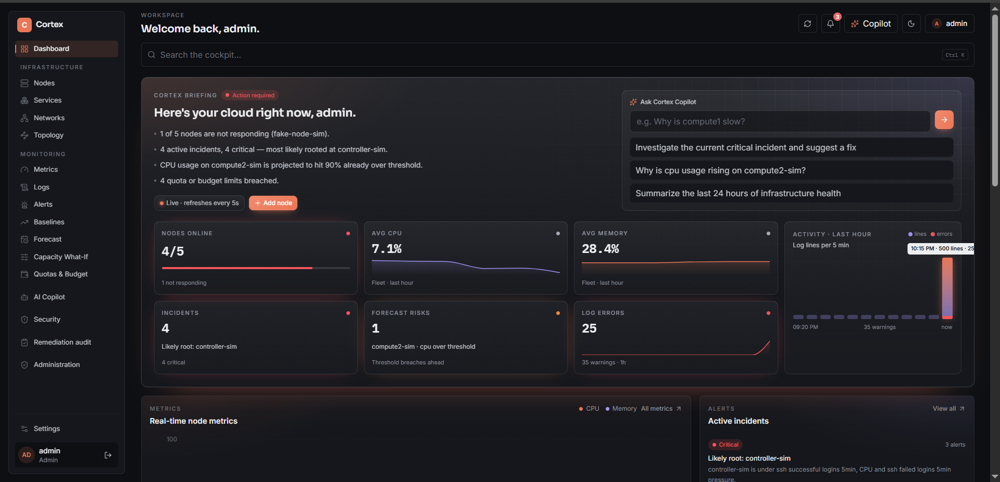<br/>**Command dashboard** — live CPU/RAM/disk/network, incidents, security, cost | 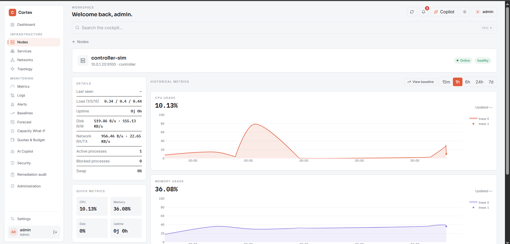<br/>**Nodes** — registry, roles, per-node metrics |
| 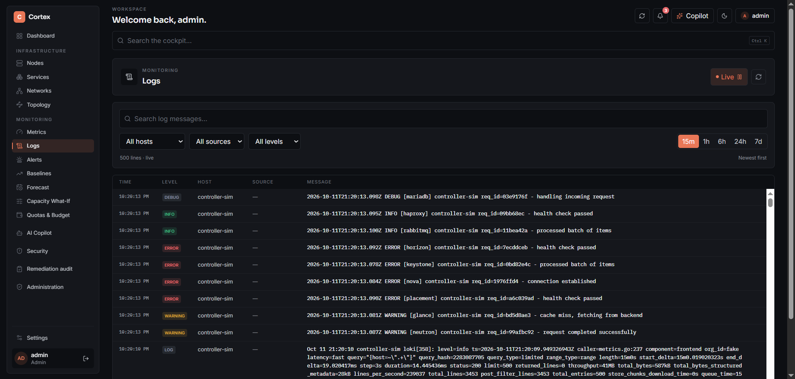<br/>**Logs** — Loki-backed search by host/severity | 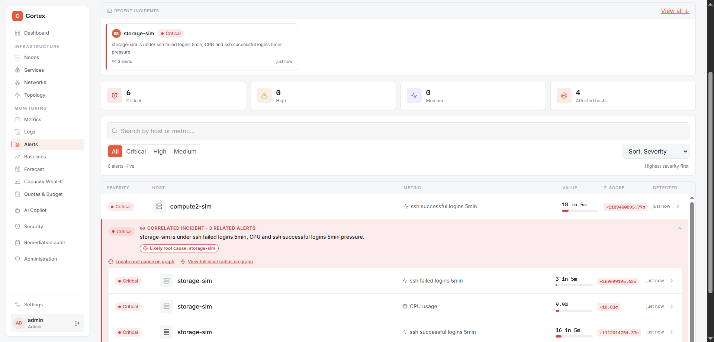<br/>**Alerts & correlated incidents** with RCA |
| 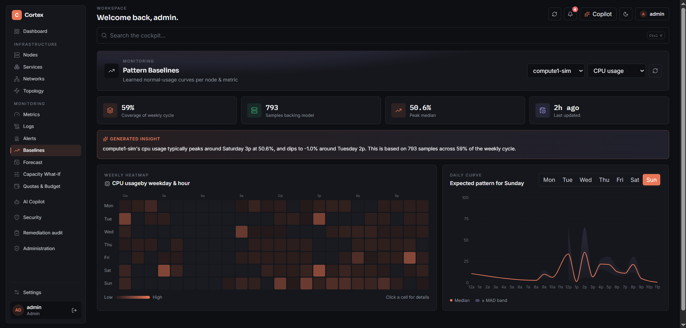<br/>**Baselines** — weekday × hour heatmap | 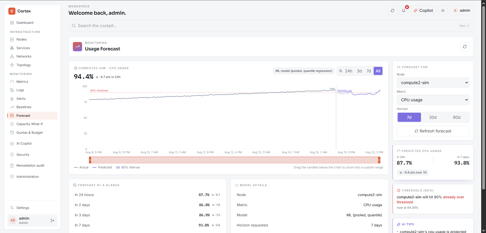<br/>**Forecast** — quantile bands up to 90 days |
| 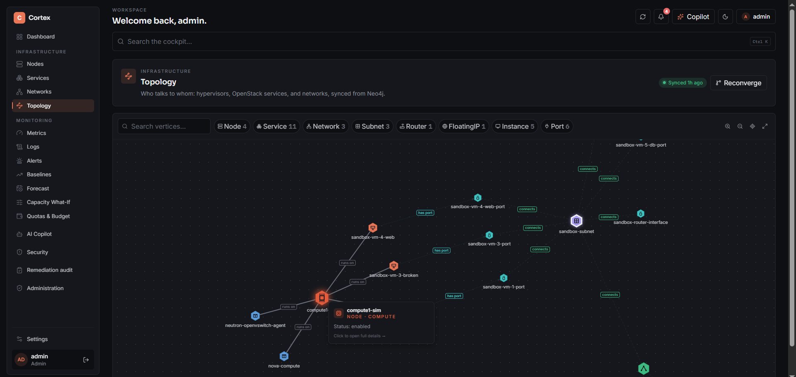<br/>**Living Model** — interactive topology graph | 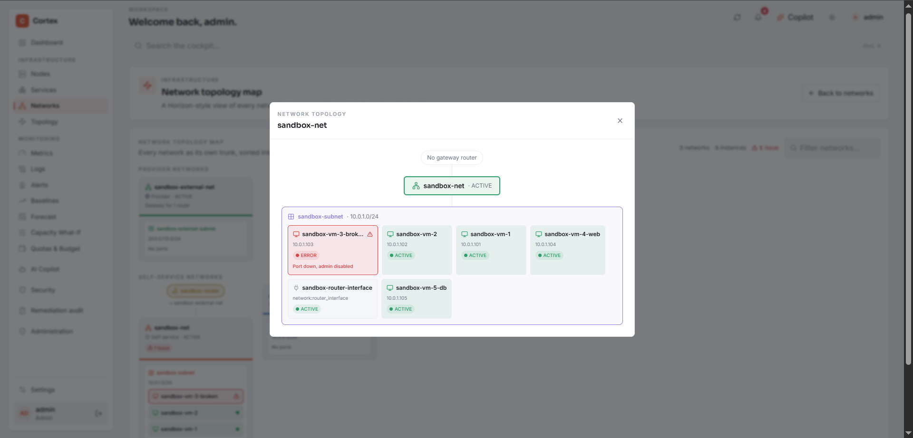<br/>**Network topology map** |
| 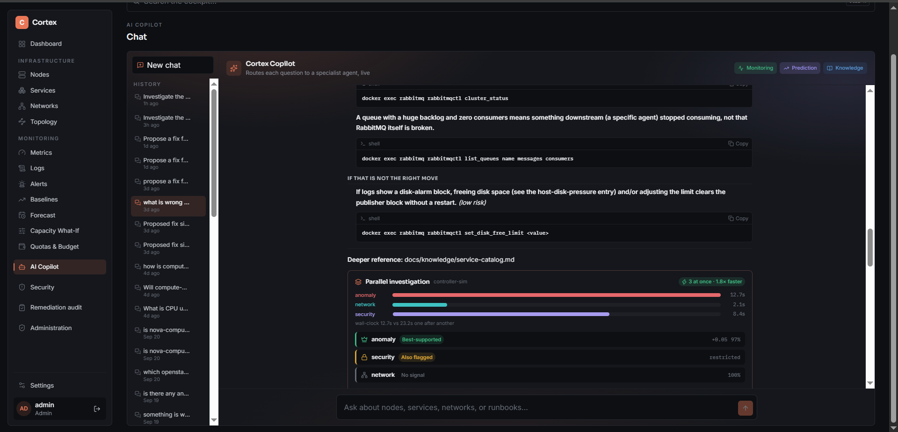<br/>**AI Copilot** — one chat for every agent | 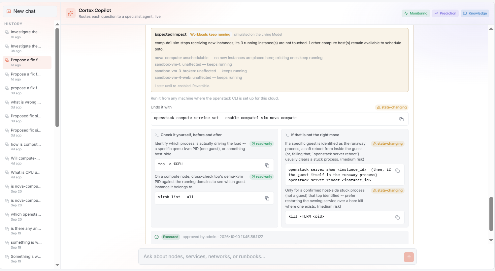<br/>**Fix proposal + simulated impact + approval** |
| 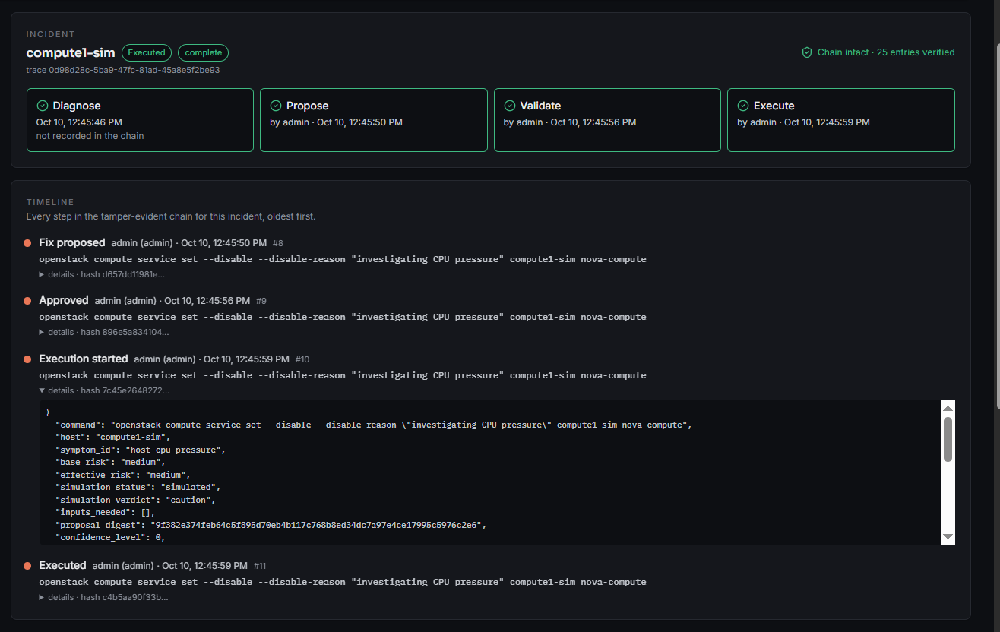<br/>**Remediation audit** — end-to-end incident timeline | 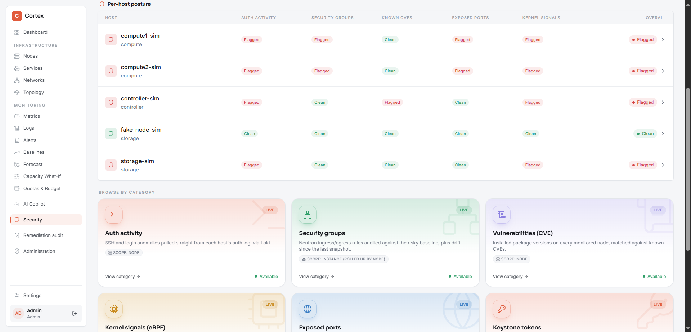<br/>**Security posture** — groups, ports, tokens, kernel signals |
| 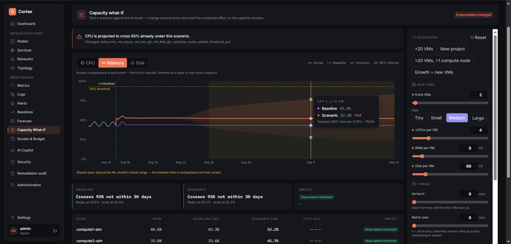<br/>**Capacity What-If** simulator |  |

---


### Design principles

| Principle | What it means in practice |
|---|---|
| **No mock data in the product** | Dashboards read real Prometheus / Loki / Nova / Neutron / Cinder data. Sandboxes exist only to *feed* the same pipelines. |
| **Honest about uncertainty** | Missing or stale telemetry is `unknown`, never silently "healthy". Degraded agent findings are labelled as degraded. |
| **Explainable by construction** | Remediation commands come from a reviewed catalog, impact simulation is rule-based, risk is a transparent score — no LLM improvisation on production commands. |
| **Human in the loop (Confidence Ladder Level 0)** | Cortex recommends → a person approves → a person clicks → only then does anything run. |
| **Fail safe, never hang** | Every agent call has a timeout, one retry, a circuit breaker and a degraded-answer path. |
| **Everything is auditable** | Every agent turn is traced; every remediation decision is written to an append-only, hash-verifiable audit log. |

---

## 2. Feature overview

| Domain | Capabilities |
|---|---|
|  **Monitoring** | `node_exporter` on every node, Prometheus (20 s scrape), Loki log aggregation, live dashboard, node registry with roles, container health |
|  **Anomaly detection** | Robust (median/MAD) z-score on weekday × hour baselines, EWMA cold-start fallback, persistence & sensitivity tuning, SSH brute-force detection, alert correlation |
|  **Living Model** | Neo4j topology graph populated from OpenStack APIs + Prometheus; Prometheus cross-check; container-level health; graph-based RCA |
|  **Prediction** | Pooled quantile-regression forecasts (p10/p50/p90) up to 90 days, threshold-breach ETAs, capacity what-if simulator |
|  **Multi-agent cockpit** | LangGraph orchestrator + 9 specialist agents, parallel incident investigation with arbitration, critic node, session memory |
|  **RAG** | Grounded, citation-enforcing chat over internal runbooks + official OpenStack docs + community-search fallback |
|  **Security** | Auth-abuse detection, security-group drift, exposed ports, Keystone token audit, Falco eBPF alerts, Trivy CVE correlation |
|  **Remediation** | Proposal → impact simulation → approve/reject/ask-info → gated execution via Ansible / OpenStack SDK → audit chain |
|  **FinOps** | Private-cloud cost model, showback/chargeback, budget vs capacity alerts, VM right-sizing |
|  **Reporting & notifications** | Severity-based alert routing + escalation, weekly digest email, executive / financial / technical PDF reports |
|  **Access control** | JWT auth, `admin` / `operator` / `viewer` RBAC, forced first-login password change |

---


## 4. Architecture

### 4.1 System context

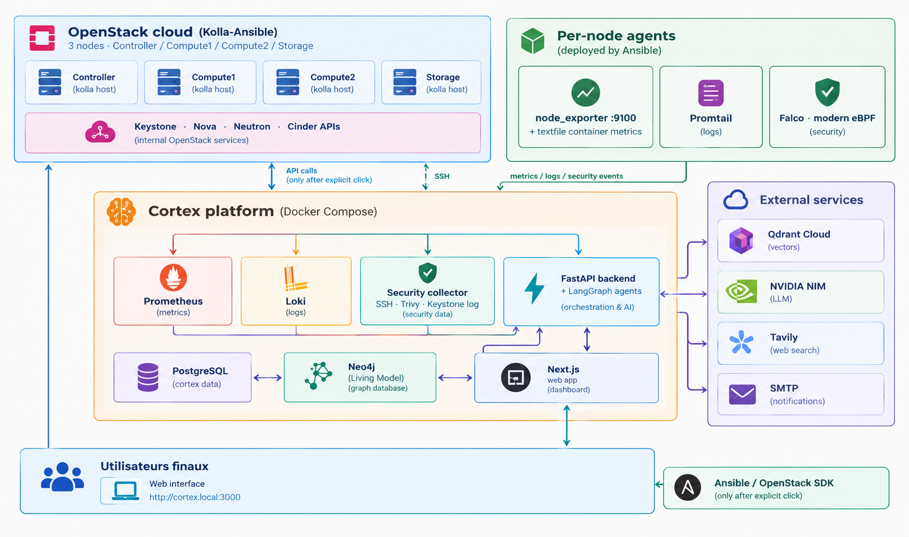

### 4.2 Layered view

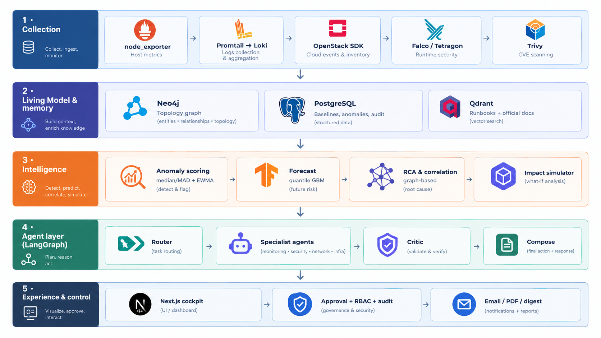

### 4.3 Background jobs

The API process runs a set of resilient periodic loops (each isolated, so one failure never stalls another):

| Job | Default interval | Purpose |
|---|---|---|
| Anomaly detection | 30 s | Score metrics vs baseline, open/upgrade/resolve alerts |
| Alert dispatch | 10 s | Outbox → SMTP with exponential backoff, escalations |
| Prometheus health sync | 30 s | Overlay `up{}` + container state on the graph |
| Security scan | 45 s | Refresh security finding cache |
| Topology sync | 5 min | Nova/Neutron/Cinder → Neo4j |
| Quota & budget check | 5 min | Capacity-cap vs budget-cap alerts, FinOps metering |
| Weekly-digest tick | 5 min | Send when the configured slot is due |
| Baseline refresh | 1 h | Rebuild weekday × hour baselines |
| Forecast dataset + training | 1 h | Rebuild features, retrain pooled quantile models |
| Security-group snapshots | 15 min | Append-only snapshots for drift diffs |

---

## 5. Tech stack

| Layer | Technology |
|---|---|
| **Frontend** | Next.js 16 (App Router), React 19, TypeScript, Tailwind CSS 4, SWR, Recharts, Plotly, `react-force-graph-2d`, Framer Motion, `react-markdown` |
| **Backend** | Python 3.12, FastAPI, Uvicorn, SQLAlchemy 2, Alembic, Pydantic |
| **Relational store** | PostgreSQL 16 |
| **Graph store** | Neo4j 5 Community (Living Model) |
| **Vector store** | Qdrant Cloud (`cortex-knowledge`, `cortex-openstack-official-docs`) |
| **Embeddings** | `BAAI/bge-small-en-v1.5` via `sentence-transformers`, baked into the image, fully offline at runtime |
| **LLM** | NVIDIA NIM (`nvidia/nemotron-3-super-120b-a12b`) through LangChain `ChatNVIDIA` |
| **Agents** | LangGraph, LangChain Core |
| **ML** | scikit-learn (`HistGradientBoostingRegressor` quantile models), pandas, SciPy, joblib |
| **Metrics** | Prometheus + `node_exporter` 1.8.2 (+ textfile collector) |
| **Logs** | Loki + Promtail 3.6 (Grafana datasource provisioned) |
| **Security** | Falco (modern eBPF driver), Tetragon-compatible bridge, Trivy, Keystone access-log audit |
| **Cloud integration** | `openstacksdk` 4.18 (Keystone, Nova, Neutron, Cinder) |
| **Automation** | Ansible Core 2.17 (deployment + approved remediation) |
| **Reporting** | ReportLab (PDF), HTML email (inline CSS, dark-mode aware) |
| **Auth** | bcrypt + PyJWT |
| **Quality** | pytest (1,000+ test functions), Ruff, GitHub Actions, golden-set evals |
| **Packaging** | Docker, Docker Compose (dev / sandbox / prod / security overlays) |

---

## 6. Monitoring

**Pipeline:** `node_exporter` (:9100) on each node → Prometheus (20 s scrape, targets generated via file-based service discovery with `node` and `role` labels) → Cortex API → dashboard.

- **Node registry** — add / edit / remove a node and assign it a role (controller / compute / storage). The API regenerates Prometheus `file_sd` targets automatically, and can install `node_exporter` on new hypervisors discovered through OpenStack.
- **Live dashboard** — CPU, RAM, disk and network per node, log stream, incident, security, network, cost and remediation widgets; auto-refreshing, no dummy data.
- **Logs** — Promtail ships every node's logs to Loki; the UI filters by host, source and severity.
- **Container health** — OpenStack services run as containers. A systemd timer on each node writes `cortex_container_up`, `cortex_container_restart_count` and a scrape timestamp through node_exporter's textfile collector, so containers such as `rabbitmq`, `mariadb`, `keystone`, `haproxy` or `nova_libvirt` are visible in the model. Stale data is `unknown`, never "running"; a container that vanishes from a fresh scrape is `missing` (critical).
- **Metrics explorer** — historical charts per node and metric.

---

## 7. Anomaly detection

Flat z-scores page people for nothing. Cortex scores each reading against *what is normal for that node at that weekday and hour*.

| Mechanism | Detail |
|---|---|
| **Baselines** | Per `(host, metric, weekday, hour)` from up to 21 days of 5-minute history, refreshed hourly. Monday 9 am and Sunday 3 am have visibly different curves. |
| **Robust scoring** | Median + MAD (×1.4826) instead of mean + stddev — one contaminated day cannot poison the baseline ([ADR-0001](docs/architecture/adr-0001-baseline-median-mad.md)). Default cut-offs 2 / 3 / 4 → **medium / high / critical**. |
| **Cold start** | Thin slots (< 10 samples) fall back to a persisted **EWMA** estimate; each flag records which method scored it and how much data backed it. |
| **Role baselines** | Per-role (controller / compute / storage) reference profiles. |
| **Auth metrics** | Loki-backed `ssh_failed_logins_5min` / `ssh_successful_logins_5min`, with source IPs attached as flag details. |
| **Sensitivity tuning** | `low` / `balanced` / `high` / `custom` presets for z-score cut-offs, SSH failed-login floors, and *persistence* (how long a reading must stay abnormal before an alert opens). Edited from Settings; service-state alerts (a node or container down) are facts and are never tuned. |
| **Correlation** | Related alerts are merged into one incident narrative using the topology graph instead of being listed separately. |
| **Lifecycle** | Alerts open, upgrade severity, auto-resolve, can be manually resolved or acknowledged (admin/operator), with full history. |

---

## 8. The Living Model (digital twin)

Cortex stores the infrastructure as a **Neo4j graph** populated from OpenStack APIs and reconciled against Prometheus.

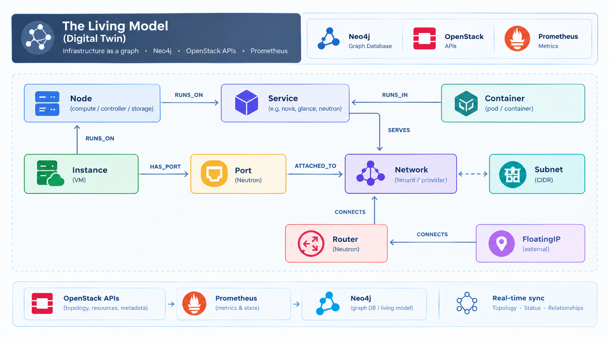

- **Sync** — Nova hypervisors/services/servers, Neutron networks/subnets/routers/ports/agents/floating IPs, Cinder services → Neo4j via a **reader-only** `cortex-reader` account (`clouds.yaml` mounted read-only). One polling loop, one source of truth ([ADR-0002](docs/architecture/adr-0002-topology-graph.md)).
- **Prometheus cross-check** — `Node.health` is `up` / `down` / `unknown` from `up{job="node_exporter"}`; `Service.state` is reconciled between OpenStack's own report, host liveness and container state ([ADR-0003](docs/architecture/adr-0003-prometheus-cross-check.md), [ADR-0012](docs/architecture/adr-0012-container-health.md)).
- **Graph-based RCA** — correlated alerts become a single incident whose "X caused Y" narrative cites the graph relationship, not just metric names.
- **Impact reasoning** — the same graph answers "what runs on this host, which instances sit on networks it serves, which floating IPs sit behind its routers" for the remediation simulator.
- **UI** — interactive topology graph, node detail panel, network topology map, per-network diagrams, resync button.

---

## 9. Forecasting & capacity planning

- **Model** — one pooled `HistGradientBoostingRegressor` per quantile (p10 / p50 / p90) per metric (`cpu_percent`, `memory_percent`, `disk_percent`), trained across all hosts. Forecasting is **direct** (horizon is a feature), not a recursive rollout, so nothing compounds ([ADR-0006](docs/architecture/adr-0006-forecast-pooled-quantile-model.md)).
- **Fallback** — `fallback_persistence` for thin-history hosts: holds the last observed value and widens the interval with `z·vol·√horizon`. Every output is clipped to `[0, 100]` and quantile-ordered.
- **Horizons** — 24 h to **90 days**, with a confidence band that widens with horizon; refreshed hourly.
- **Threshold ETA** — "disk on *storage* will hit 85 % in ~N days" warnings on the dashboard.
- **Capacity What-If simulator** — change several levers at once (extra VMs, VM size and utilisation, start day / ramp, organic growth, hardware added, threshold) and compare **baseline vs scenario** capacity timelines, with the day each resource first crosses its limit.
- Benchmarks and model comparisons live in `notebooks/`.

---

## 10. Agentic AI

### 10.1 Orchestration

A **LangGraph** state graph routes every chat message. The router is an LLM classifier with a confidence gate — below the threshold it **asks a clarifying question instead of guessing**.

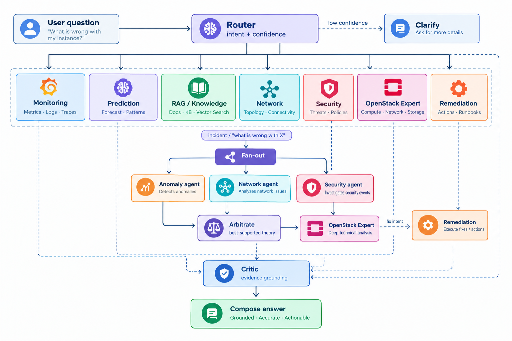

### 10.2 The agents

| Agent | Responsibility |
|---|---|
| **Router** | Classifies intent into one of 8 targets, resolves node names, can decline to guess. |
| **Monitoring** | Live CPU / RAM / disk / uptime / health for one or many nodes. |
| **Prediction** | Forecasts and threshold-breach ETAs ("will X run out of disk?"). |
| **RAG (Knowledge)** | Answers from internal runbooks with citations. |
| **Anomaly** | Sub-orchestrates a metric check + log check into one finding. |
| **Network** | Router / floating-IP / port / agent health, inter-node latency, traffic signals. |
| **Security** | Auth bursts, security-group diffs, exposed ports, Keystone tokens, eBPF alerts, CVEs. |
| **OpenStack Expert** | Curated symptom → command → doc catalog (read-only confirm commands vs labelled state-changing fixes), official-docs RAG, community-search fallback. |
| **Remediation** | Deterministic, proposal-only fix with risk, undo, simulated impact. |
| *Critic* | Deterministic evidence-grounding check — flags numbers that don't exist in the agents' raw data. |

### 10.3 Parallel incident investigation

For broad incident questions, Cortex **fans out three agents concurrently per node** (Anomaly, Network, Security) and joins them in an arbitration step that weighs cross-agent corroboration and records *why* the winning theory won. Logs show START/DONE lines with worker threads, and the join records measured parallelism (peak concurrency, wall-clock vs sequential). The expert chain then walks the runbook for the winner's evidence.

### 10.4 Reliability & observability

- **Resilience layer** — hard timeouts, one retry, circuit breaker, `FailureRecord`s, degraded answers clearly labelled, clarification gate ([ADR-0007](docs/architecture/adr-0007-resilience-layer.md)).
- **Tracing** — one `AgentTrace` per turn: router choice, agents run, findings, degradations ([ADR-0009](docs/architecture/adr-0009-observability-and-eval.md)).
- **Evals in CI** — routing golden set (needs `NVIDIA_API_KEY`) and a fully offline arbitration golden set.
- **Onboarding mode** — agents explain *why* they're investigating a certain way.
- **Memory** — conversation history persists per user/session; agent session memory for follow-ups.
- **Streaming** — chat responses stream over SSE.

---

## 11. RAG & knowledge base

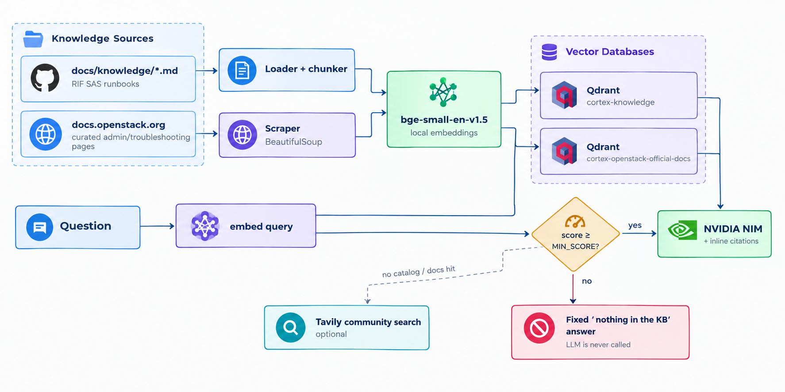

- **Three corpora, three jobs** — internal runbooks ("how did *we* fix it?"), official OpenStack docs ("what does OpenStack recommend?"), community search (Launchpad, mailing lists, Q&A) kept strictly separate so every citation is unambiguous.
- **Hard anti-hallucination guarantee** — chunks below `KNOWLEDGE_CHAT_MIN_SCORE` are dropped; if none remain, the LLM is *never called*. Answers must cite `[source-file.md]`.
- **On-demand ingestion** — `POST /api/v1/knowledge/ingest` or the `ingest_knowledge` / `ingest_openstack_docs` scripts. The knowledge corpus lives in `docs/knowledge/` (git-ignored; documented in its README).
- **Vector store choice** — the original backlog planned `pgvector`; the shipped design uses **Qdrant Cloud** so vector load and lifecycle stay independent of Postgres and Neo4j ([ADR-0004](docs/architecture/adr-0004-knowledge-rag-qdrant-cloud.md), [ADR-0005](docs/architecture/adr-0005-knowledge-chat-nim-langchain.md), [ADR-0010](docs/architecture/adr-0010-openstack-expert-v1-expansion.md)).
- **Feedback loop** — resolved incidents can grow the symptom catalog (stored in Postgres `catalog_entries`).

---

## 12. Remediation Copilot

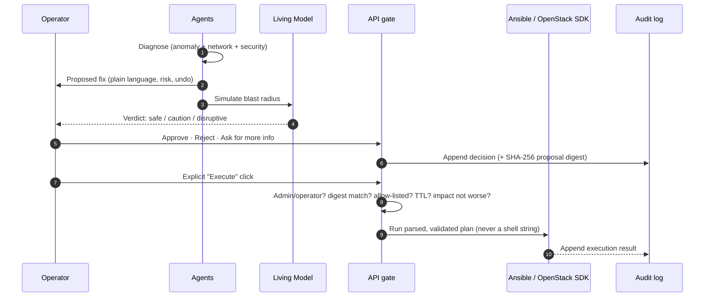

- **Proposal-only agent** — commands come from the reviewed catalog; the agent picks one recommended step (runnable-now → lowest risk), derives risk from the command text, a derived exact **undo**, where to run it, and checks to do before/after ([ADR-0011](docs/architecture/adr-0011-remediation-agent.md)).
- **Impact simulation** — read-only graph lookups + explicit rules; honest statuses (`simulated` / `unmodelled` / `unavailable`, never presented as "safe"); *risk only goes up* ([ADR-0013](docs/architecture/adr-0013-impact-simulation.md)).
- **Approve / Reject / Ask-for-info** — decisions refer to a **server-side snapshot** (never to what the browser sends); status change and audit entry commit together under a row lock ([ADR-0014](docs/architecture/adr-0014-remediation-approval.md)).
- **Gated execution (Confidence Ladder Level 0)** — a single service-level gate checks role, execution switch, proposal digest, status, unresolved placeholders, command allow-list, impact drift, **an `approved` entry in the audit trail itself**, and approval TTL. Destructive operations (deletes, rebuilds, prunes, compound commands) are never run ([ADR-0015](docs/architecture/adr-0015-remediation-execution.md)).
- **Tamper-evident audit** — append-only `remediation_audit_log` (Postgres trigger rejects UPDATE/DELETE/TRUNCATE), actor snapshots, a verify endpoint, and a per-incident end-to-end timeline: *diagnose → propose → validate → execute*.
- **RBAC** — see [§13.4](#134-access-control).
- **Sandbox** — `openstack-sim` accepts writes only for the `cortex-operator` profile; `cortex-docker-sim` makes a "restart" visibly flip a simulated container from down → healthy ([`infra/SANDBOX-REMEDIATION.md`](infra/SANDBOX-REMEDIATION.md)).

---

## 13. Security

### 13.1 Signals collected

| Signal | Source | What Cortex does |
|---|---|---|
| **Abnormal auth behaviour** | Loki auth logs → `ssh_failed_logins_5min`, odd-hour logins | Brute-force bursts flagged within a minute; source IPs shown in *Auth activity* |
| **Security-group drift** | Neutron snapshots every 15 min (append-only) | "What changed, was it expected" before/after diff; static risk reasons (e.g. world-open ports) |
| **Exposed ports** | Node listening ports + instance exposure analysis via the graph (instance → port → security group → floating IP) | Per-host and per-instance exposure tables |
| **Keystone token audit** | Keystone access log via collector | Tokens issued from unexpected CIDRs / odd patterns |
| **Kernel-level signals (eBPF)** | **Falco** (modern eBPF driver) on nodes → HTTP output → collector; Tetragon-compatible bridge in sandbox | Highest-confidence sub-check (0.95) for the Security agent; min-priority and ignore-regex filters; *Kernel signals* page |
| **CVE correspondence** | **Trivy** run via Docker on each node by the collector + package inventory | CVEs matched to installed component versions, including unfixed CVEs and old kernels apt cannot show; severity floor and per-host opt-out |

### 13.2 The security collector

`infra/collector` is a small FastAPI service for the real cloud that serves exactly the shapes the API's sandbox bridges serve, so no API code changes between sandbox and production:

```
GET  /packages?host=…          GET  /listening-ports?host=…
GET  /alerts[?host=…]          POST /falco?token=…   (Falco http_output)
GET  /_sandbox/keystone/token-log
```
Data is read over SSH (same key + inventory as Ansible). An unreadable source answers **503**, which the API turns into a degraded `unknown` — never a false "all clear".

### 13.3 Security UI

Security posture · Auth activity · Security groups (+ per-host drift) · Exposed ports · Keystone tokens · Vulnerabilities (CVE findings) · Kernel signals · Security audit log.

### 13.4 Access control

| Role | Can do |
|---|---|
| **admin** | Everything: manage users/nodes/settings, validate & execute **any** risk level, send digests, change alert recipient |
| **operator** | Validate & execute **low / medium** risk fixes, acknowledge alerts, read the audit trail |
| **viewer** | Read-only; may *ask for more info* on a proposal but never decide, execute or acknowledge |

Unknown risk is treated as **high** — an unknown can never be easier to approve than a known one. All routers sit behind JWT auth; the bootstrap admin must change their password on first login.

---

## 14. FinOps, reports & notifications

### FinOps for OpenStack IaaS ([ADR-0016](docs/architecture/adr-0016-finops-private-cloud-cost-model.md))

An OpenStack deployment has a **fixed infrastructure bill**, not a price list. Cortex derives rates instead of inventing them:

- `unit rate = cost pool ÷ sellable units`; the monthly bill is split into *compute*, *storage* and *platform* pools. Sellable units come from Nova hypervisor and Cinder pool capacity × the planned overcommit ratio.
- **Showback** (direct cost = reserved × rate) and **chargeback** (direct + platform share + idle share, so projects together pay exactly the bill).
- **Idle capacity** is a first-class number.
- **Quota vs budget alerts** that explicitly say `CAPACITY CAP` vs `BUDGET CAP`; budgets editable per project; project → department mapping.
- Exports as **PDF and CSV**.

### VM right-sizing ([ADR-0018](docs/architecture/adr-0018-vm-right-sizing.md))
Recommendation-only: judged on p95, guarded on peak, never grows a dimension, never shrinks saturated VMs, no score on < 24 h of data; savings reuse the FinOps unit rates and carry a risk label and efficiency score.

### Alert routing & escalation ([ADR-0017](docs/architecture/adr-0017-alert-routing-and-rbac.md))

| Severity | Dashboard | Email | Escalation |
|---|---|---|---|
| medium | ✅ | ❌ | never |
| high | ✅ | ✅ | after 60 min unacknowledged |
| critical | ✅ | ✅ | after 15 min unacknowledged |

An **outbox** (not inline SMTP) decouples detection from delivery with exponential-backoff retries; severity upgrades are emailed once per (episode, channel, kind, severity).

### Weekly digest ([ADR-0020](docs/architecture/adr-0020-weekly-digest.md))
Scheduled HTML email: capacity trend, security posture, what the agents caught — with an AI summary that **falls back to a deterministic summary** so delivery never depends on the LLM. Restart-safe, multi-replica-safe scheduling.

### Professional PDF reports ([ADR-0019](docs/architecture/adr-0019-professional-reports.md))
`executive` (one page), `financial`, `technical` — one visual language, built on ReportLab, assembled from the owners of each figure (no re-derived numbers), every source optional, synthetic data labelled "DEMO DATA".

---

## 15. OpenStack adoption

Cortex treats OpenStack as a first-class citizen rather than a generic "VM fleet":

| Area | How Cortex adopts it |
|---|---|
| **Deployment model** | Understands containerised OpenStack services (e.g. `nova_compute` ↔ `nova-compute`); Ansible roles use a `controllers / computes / storages` inventory |
| **Identity** | Reader-only `cortex-reader` (Keystone `reader`) for discovery; a separate `cortex-operator` profile used **only** by the Execute button |
| **Compute (Nova)** | Hypervisors, services, servers, quotas, flavors (right-sizing candidates), service enable/disable as an allow-listed fix |
| **Network (Neutron)** | Networks, subnets, routers, ports, floating IPs, DHCP/L3 agents; router/FIP/port health and inter-node latency |
| **Block storage (Cinder)** | Services, backend pools, volume quota → FinOps storage pool |
| **Security** | Security groups (drift), Keystone token log, exposed instance ports |
| **Quotas & budgets** | Nova/Cinder limits per project → showback/chargeback, capacity-cap alerts |
| **Knowledge** | Official docs.openstack.org corpus + curated symptom catalog (Nova, Neutron, Cinder, RabbitMQ, MariaDB, Keystone, HAProxy, libvirt…) |
| **Real vs sandbox** | `infra/openstack-sim` implements enough Keystone v3 / Nova / Cinder / Neutron REST for `openstacksdk` to work, so the whole pipeline runs without a cloud — and swapping to the real `clouds.yaml` is purely configuration |


---

## 16. Backend services & API

**Routers** (all behind JWT except `/auth`): `nodes`, `metrics`, `dashboard`, `logs`, `anomalies`, `baselines`, `forecast`, `topology`, `network`, `quotas`, `rightsizing`, `reports`, `capacity`, `knowledge`, `openstack-docs`, `openstack-expert`, `agents` (`/orchestrate`), `conversations`, `remediation`, `security`, `settings`, `auth`.

**Selected service modules** (`services/api/app/services/`):

| Concern | Modules |
|---|---|
| Collection | `metrics_collector`, `prometheus`, `prometheus_sd`, `prometheus_health`, `inventory_manager`, `ansible_runner`, `auth_log_metrics` |
| Detection | `anomaly_detector`, `baseline_builder`, `detection_settings`, `alert_correlation`, `rca_suggester`, `alert_routing`, `alert_email` |
| Living Model | `topology_sync`, `container_health`, `network_health`, `network_latency`, `graph_db` |
| Prediction | `forecast_dataset_builder`, `forecast_features`, `forecast_trainer`, `forecast_service`, `capacity_simulator` |
| Security | `security_audit`, `security_snapshot_builder`, `security_sandbox`, `keystone_audit`, `ebpf_signal`, `instance_exposure`, `security_rbac` |
| Remediation | `impact_simulator`, `remediation_approval`, `remediation_execution`, `remediation_executor`, `remediation_audit` |
| FinOps & reports | `finops`, `quota_budget_monitor`, `finops_report`, `rightsizing`, `rightsizing_service`, `vm_utilization`, `reports`, `report_pdf`, `weekly_digest`, `weekly_digest_email` |
| AI | `knowledge/` (loader, embeddings, qdrant_store, chat), `openstack_docs/`, `web_search`, `llm_client` |

Interactive API docs are served by FastAPI at `http://localhost:8000/docs`. See also [`topology-api-endpoints.md`](docs/architecture/topology-api-endpoints.md) and [`alert-correlation-endpoint.md`](docs/architecture/alert-correlation-endpoint.md).

---

## 17. Data model

**PostgreSQL** (Alembic-managed, ~30 migrations): `users`, `nodes`, `anomaly_flags`, `anomaly_events`, `detection_settings`, `alert_notifications`, `alert_email_settings`, `ewma_state`, `baselines`, `role_baselines`, `quota_alerts`, `project_finops_settings`, `finops_project_samples`, `finops_cloud_samples`, `conversations`, `conversation_messages`, `agent_session_memory`, `agent_traces`, `topology_sync_runs`, `remediation_proposals`, `remediation_audit_log` (append-only), `security_group_snapshots`, `security_scan_runs`, `security_finding_cache`, `catalog_entries`.

**Neo4j** — `Node`, `Service`, `Container`, `Instance`, `Network`, `Subnet`, `Router`, `Port`, `FloatingIP` with `RUNS_ON`, `RUNS_IN`, `SERVES`, `CONNECTS`, `HAS_PORT`, `ATTACHED_TO`.

**Qdrant** — `cortex-knowledge` (internal runbooks), `cortex-openstack-official-docs`.

---

## 18. Repository layout

```
Cortex/
├── .github/workflows/ci.yml        # lint + migrations + tests + router golden-set eval
├── docs/
│   ├── architecture/               # 20 ADRs + API notes
│   └── knowledge/                  # RAG corpus (git-ignored, see README inside)
├── infra/
│   ├── docker-compose.yml          # base: postgres, neo4j, api, web
│   ├── docker-compose.sandbox.yml  # fake nodes + OpenStack sim
│   ├── docker-compose.prod.yml     # real cloud
│   ├── docker-compose.security.yml # security collector overlay
│   ├── ansible/                    # real deploy: node_exporter, prometheus, loki, promtail,
│   │                               #   grafana, falco, container_metrics, remediation playbook
│   ├── ansible-sandbox/            # sandbox roles + simulators (logs, SSH auth, eBPF, containers)
│   ├── collector/                  # security collector (SSH, Trivy, Keystone log, Falco intake)
│   ├── openstack-sim/              # fake Keystone/Nova/Cinder/Neutron
│   ├── tetragon-bridge-sim/        # fake Falco/Tetragon alert bridge
│   └── prometheus/                 # prometheus.yml + file_sd targets
├── notebooks/                      # forecast, baseline & anomaly-detection benchmarks
└── services/
    ├── api/                        # FastAPI + LangGraph agents
    │   ├── app/{agents,routers,services}/
    │   ├── alembic/versions/
    │   └── tests/                  # 1,000+ test functions + golden sets
    └── web/                        # Next.js cockpit
        ├── app/                    # pages + API proxy routes
        └── components/ lib/
```

---

## 19. Getting started

### Prerequisites
Docker + Docker Compose, a Qdrant Cloud cluster (free tier is fine), an NVIDIA NIM API key. (Tavily key optional.)

### Sandbox (no OpenStack required)

```bash
git clone https://github.com/LAKHAL-Farah/Cortex.git
cd Cortex/infra

cp .env.example .env
# edit .env — at minimum: CORTEX_DB_PASSWORD, CORTEX_API_KEY, CORTEX_JWT_SECRET,
# CORTEX_NEO4J_PASSWORD, QDRANT_URL, QDRANT_API_KEY, NVIDIA_API_KEY

docker compose -f docker-compose.yml -f docker-compose.sandbox.yml up -d --build
```

| Service | URL |
|---|---|
| Web cockpit | http://localhost:3000 |
| API + Swagger | http://localhost:8000/docs |
| Neo4j Browser | http://localhost:7474 |

Log in with the bootstrap account (`admin` / `admin` by default) — **you are forced to change the password on first login.**

Then ingest knowledge (admin):

```bash
curl -X POST http://localhost:8000/api/v1/knowledge/ingest   # internal runbooks
docker compose exec api python -m app.scripts.ingest_openstack_docs   # official docs
```

See [`infra/ansible-sandbox/README.md`](infra/ansible-sandbox/README.md), [`infra/openstack-sim/README.md`](infra/openstack-sim/README.md) and [`infra/SANDBOX-REMEDIATION.md`](infra/SANDBOX-REMEDIATION.md) for the simulators, and for demonstrating the full *detect → explain → propose → approve → execute* chain.

### Real OpenStack environment

1. Provide SSH access and an inventory (`infra/ansible/inventory/hosts.ini`) with `controllers`, `computes`, `storages` groups.
2. Deploy collection agents:
   ```bash
   cd infra/ansible
   ansible-playbook site.yml                 # node_exporter, Prometheus, Loki, Promtail, Grafana, container metrics
   ansible-playbook playbook-falco.yml -e falco_collector_token=…   # eBPF sensors
   ansible-playbook verify.yml               # automated acceptance checks
   ```
3. Create a **reader-only** Keystone user (`cortex-reader`) and, if you want gated execution, a separate `cortex-operator`; put both in a `clouds.yaml` outside the repo (`CORTEX_OPENSTACK_HOST_DIR`).
4. Launch with the prod + security overlays:
   ```bash
   docker compose -f docker-compose.prod.yml -f docker-compose.security.yml --env-file .env.prod up -d --build
   ```
5. Tune the cost model (`FINOPS_*`) and anomaly sensitivity (Settings → *Anomaly detection*) against your own environment.

> **Production defaults:** remediation execution is **off** unless `CORTEX_REMEDIATION_EXECUTION=live`, and the sandbox-only one-click "Approve & execute" button is always disabled when `CORTEX_ENV=production`.

### Local development

```bash
# API
cd services/api && pip install -r requirements.txt
alembic upgrade head && uvicorn app.main:app --reload

# Web
cd services/web && npm install && npm run dev
```

---

## 20. Configuration

Everything is environment-driven; see [`infra/.env.example`](infra/.env.example) for the full annotated list. Key groups:

| Group | Variables |
|---|---|
| **Core / auth** | `CORTEX_DB_PASSWORD`, `CORTEX_API_KEY`, `CORTEX_JWT_SECRET`, `CORTEX_JWT_TTL_MINUTES`, `CORTEX_ADMIN_USERNAME/PASSWORD` |
| **Graph** | `CORTEX_NEO4J_PASSWORD`, `NEO4J_URI`, `OS_CLOUD`, `CORTEX_OPENSTACK_HOST_DIR` |
| **Monitoring** | `PROMETHEUS_URL`, `LOKI_URL`, `ANOMALY_DETECTION_INTERVAL_SECONDS` |
| **Alerts & email** | `SMTP_*`, `ALERT_EMAIL_SEVERITIES`, `ALERT_ESCALATE_*_AFTER_MINUTES`, `ALERT_ESCALATION_RECIPIENT_EMAIL`, `CORTEX_PUBLIC_URL` |
| **RAG / LLM** | `QDRANT_URL/API_KEY/COLLECTION`, `EMBEDDING_MODEL`, `NVIDIA_API_KEY`, `NVIDIA_NIM_MODEL`, `NVIDIA_NIM_FAST_MODEL`, `KNOWLEDGE_CHAT_MIN_SCORE`, `TAVILY_API_KEY`, `ROUTER_CLARIFY_THRESHOLD` |
| **FinOps** | `FINOPS_MONTHLY_COST_EUR`, `FINOPS_POOL_SHARE_*`, `FINOPS_*_ALLOCATION_RATIO`, `QUOTA_PROJECT_BUDGETS_EUR`, `FINOPS_PROJECT_DEPARTMENTS` |
| **Right-sizing** | `RIGHTSIZING_*` thresholds, `RIGHTSIZING_CPU_EXPR` / `MEM_EXPR` (libvirt exporter) |
| **Remediation** | `CORTEX_REMEDIATION_EXECUTION`, `OS_REMEDIATION_CLOUD`, `CORTEX_REMEDIATION_APPROVAL_TTL_MINUTES` |
| **Security collector** | `COLLECTOR_FALCO_TOKEN`, `COLLECTOR_TRIVY_*`, `COLLECTOR_KEYSTONE_*`, `CORTEX_KEYSTONE_EXPECTED_CIDRS`, `CORTEX_EBPF_MAX_ALERTS` |

> ⚠️ Never commit `.env`, `clouds.yaml`, or SSH keys — they're git-ignored and mounted read-only into containers.

---

## 21. Testing, CI & evaluation

- **1,000+ pytest test functions** across the API: detectors, baselines, forecast, topology sync, graph integration, agents (routing, arbitration, critic, resilience, fan-out), remediation (approval, execution, sandbox), RBAC & audit, FinOps, right-sizing, reports, digest, security, RAG.
- **GitHub Actions** (`ci.yml`) on every push/PR: Python 3.12 → install → Alembic migrations against Postgres 16 → `pytest` → router golden-set eval.
- **Golden sets** — `routing_golden_set.json` (gates router-prompt changes when `NVIDIA_API_KEY` is configured) and `arbitration_golden_set.json` (fully offline).
- **Notebooks** — `forecast_benchmark`, `baseline_model_comparison`, `anomaly_detection_comparison`, `forcasting` justify the modelling choices.
- **Lint** — Ruff.

---

## 22. Architecture Decision Records

| ADR | Decision |
|---|---|
| [0001](docs/architecture/adr-0001-baseline-median-mad.md) | Median/MAD weekday × hour baselines |
| [0002](docs/architecture/adr-0002-topology-graph.md) | Topology graph: reader-only `clouds.yaml`, single discovery loop |
| [0003](docs/architecture/adr-0003-prometheus-cross-check.md) | Prometheus cross-check & service-state reconciliation |
| [0004](docs/architecture/adr-0004-knowledge-rag-qdrant-cloud.md) | Qdrant Cloud + local embeddings, on-demand ingestion |
| [0005](docs/architecture/adr-0005-knowledge-chat-nim-langchain.md) | Grounded chat via NVIDIA NIM + LangChain over SSE |
| [0005b](docs/architecture/adr-0005-knowledge-corpus-completion.md) | Knowledge corpus completion |
| [0006](docs/architecture/adr-0006-forecast-pooled-quantile-model.md) | Pooled quantile forecasting + persistence fallback |
| [0007](docs/architecture/adr-0007-resilience-layer.md) | Circuit breakers, degraded answers, clarification gate |
| [0008](docs/architecture/adr-0008-openstack-expert-agent.md) | OpenStack Expert: curated catalog + symptom matcher |
| [0009](docs/architecture/adr-0009-observability-and-eval.md) | Tracing, critic node, golden sets |
| [0010](docs/architecture/adr-0010-openstack-expert-v1-expansion.md) | Official docs, community-search fallback, feedback loop |
| [0011](docs/architecture/adr-0011-remediation-agent.md) | Deterministic, proposal-only remediation agent |
| [0012](docs/architecture/adr-0012-container-health.md) | Container health in the Living Model |
| [0013](docs/architecture/adr-0013-impact-simulation.md) | Impact simulation of proposed fixes |
| [0014](docs/architecture/adr-0014-remediation-approval.md) | Approve / reject / ask-info + tamper-evident audit |
| [0015](docs/architecture/adr-0015-remediation-execution.md) | Execute only after explicit click (Confidence Ladder L0) |
| [0016](docs/architecture/adr-0016-finops-private-cloud-cost-model.md) | FinOps for a fixed-bill OpenStack deployment |
| [0017](docs/architecture/adr-0017-alert-routing-and-rbac.md) | Alert routing/escalation + RBAC + audit chain |
| [0018](docs/architecture/adr-0018-vm-right-sizing.md) | VM right-sizing, recommendation only |
| [0019](docs/architecture/adr-0019-professional-reports.md) | On-demand professional PDF reports |
| [0020](docs/architecture/adr-0020-weekly-digest.md) | Weekly digest email |

---

## 23. Roadmap & delivery status

The project was delivered in four sprints plus extensions.

| Sprint | Theme | Status |
|---|---|---|
| **1** | Foundation & real-time monitoring (node_exporter, Prometheus, Loki, anomaly flags, dashboard, weekday×hour baselines) | ✅ Done |
| **2** | Living Model, prediction & first RAG (graph, correlated incidents, RCA, 24 h–90 d forecast, ETA, quota/budget alerts, grounded chat) | ✅ Done |
| **3** | Multi-agent orchestration, conversational cockpit, security & network (LangGraph router, parallel agents, SSH-burst detection, SG diff, Neutron health, contextual anomaly scoring) | ✅ Done |
| **4** | Remediation Copilot, reporting & polish (propose → simulate → approve → execute, digest, showback, routing, RBAC/audit, right-sizing, PDF reports, what-if simulator) | ✅ Done |

**Extension items (P2) — delivered**

| Item | Status |
|---|---|
| Full eBPF kernel-level sensors (Falco / Tetragon) — extends the Security agent | ✅ Falco (modern eBPF) Ansible role + collector intake; Tetragon-compatible bridge in sandbox |
| CVE correspondence with installed OpenStack/component versions | ✅ Trivy scan in the collector, reusing the SSH/inventory path, no new infra |

**Post-sprint hardening — delivered:** NVIDIA deprecated-model fix · digital twin now detects downed containers · FinOps adapted to OpenStack · proper notifications · RCA accuracy improvements · lower default anomaly sensitivity (tunable) with smarter correlated-incident analysis.

**Out of scope / not built:** a *chaos engineering agent* (fault injection) was intentionally not part of this delivery. Cortex still ships fault *simulators* in the sandbox (log, SSH-auth, eBPF and container simulators) to exercise the pipelines.

**Ideas for next steps:** automatic remediation at higher Confidence-Ladder levels (reviewed code change, never a setting), cross-week security trend history, per-VM libvirt exporter rollout for right-sizing, background report generation/caching.

---

<div align="center">

**Cortex** — built for operators who want answers, not just graphs.

</div>